# PostgreSQL schema

Every table stores the whole record in `doc jsonb`. All other columns are
`GENERATED ALWAYS AS (...) STORED` from `doc`, so they are read-only and exist
for indexing and filtering. Every index is over these columns, none over a
`doc` expression. The columns are declared in
`packages/server/src/service/storage/postgres/provision.ts` (`COLUMNS`) and
synced to a live database at boot by `schema.ts`.

Three kinds of generated column:

- **text**: the field at a document path, in the `doc ->> 'field'` text form
  (`is_template = 'true'`, numeric `status` stays `'1'`)
- **text[] copy**: an id array at a path, in document order
- **text[] keys**: the distinct entity ids found at several nested paths,
  computed by an IMMUTABLE key function of the same name as the index
  (`entities_props_recursive(doc)` and so on)

There are no foreign keys. The dotted lines below are references the
application resolves by id; nothing in the database enforces them.

```mermaid
erDiagram
  entities {
    jsonb doc "whole entity"
    text id PK "doc.id"
    text class "doc.class, idx (class), (class, status)"
    text status "doc.status"
    text language "doc.language"
    text is_template "doc.isTemplate"
    text used_template FK "doc.usedTemplate, idx"
    text territory_id FK "doc.data.territory.territoryId (statements), idx"
    text parent_id FK "doc.data.parent.territoryId (territories), idx"
    text document_id FK "doc.data.documentId (resources), idx"
    text created_at "doc.createdAt"
    text updated_at "doc.updatedAt"
    text[] labels "doc.labels, label search"
    text label "doc.label, explore label node"
    text[] prop_entity_ids FK "keys: prop type and value ids, 4 levels, gin"
    text[] statement_prop_entity_ids FK "keys: action and actant prop ids, 3 levels, gin"
    text[] statement_entity_ids FK "keys: actions, actants, tags, territory, gin"
    text[] reference_entity_ids FK "keys: reference resource and value, gin"
    text[] statement_actant_ci_ids FK "keys: actant classifications and identifications, gin"
  }
  relations {
    jsonb doc "whole relation"
    text id PK "doc.id"
    text type "doc.type, idx"
    text[] entity_ids FK "doc.entityIds in order, [1] source, [2] target, gin"
  }
  audits {
    jsonb doc "whole audit incl. changes"
    text id PK "doc.id"
    text date "doc.date, idx (date), (date, type, user)"
    text type "doc.type, idx (type, user)"
    text user FK "doc.user"
    text audit_scope "doc.auditScope, idx (audit_scope, model_id, date)"
    text model_id FK "doc.modelId, id of the audited record"
    text[] entity_ids FK "doc.changes.entityIds (relation audits), gin"
  }
  documents {
    jsonb doc "whole document incl. content"
    text id PK "doc.id"
    text title "doc.title"
    text created_at "doc.createdAt"
    text updated_at "doc.updatedAt"
    text[] entity_ids FK "keys: anchored entity ids, flat or per class, gin"
  }
  users {
    jsonb doc "whole user incl. rights, options, bookmarks"
    text id PK "doc.id"
    text email "doc.email, idx"
    text name "doc.name"
    text role "doc.role"
    text hash "doc.hash"
    text deleted_at "doc.deletedAt"
    text active "doc.active"
    text verified "doc.verified"
  }
  sessions {
    jsonb doc "whole session"
    text id PK "doc.id"
    text user_id FK "doc.userId, idx"
    bigint expires_at "doc.expiresAt epoch ms, idx"
  }
  saved_queries {
    jsonb doc "whole saved query"
    text id PK "doc.id"
    text name "doc.name"
    text owner_id FK "doc.ownerId, idx"
    text shared "doc.shared"
    text created_at "doc.createdAt"
    text updated_at "doc.updatedAt"
  }
  acl_permissions {
    jsonb doc "whole permission"
    text id PK "doc.id"
    text controller "doc.controller, idx (controller, method, route)"
    text method "doc.method"
    text route "doc.route"
  }
  settings {
    jsonb doc "whole setting"
    text id PK "doc.id"
    text public "doc.public"
  }
  stats_materialized_day {
    jsonb doc "aggregated counts"
    text id PK "doc.id"
    text date "doc.date, idx (date), (date, event_type, aggregate_by)"
    text event_type "doc.eventType"
    text aggregate_by "doc.aggregateBy"
    text last_updated "doc.lastUpdated, idx"
  }
  stats_materialized_week {
    jsonb doc "aggregated counts"
    text id PK "doc.id"
    text date "doc.date, idx (date), (date, event_type, aggregate_by)"
    text event_type "doc.eventType"
    text aggregate_by "doc.aggregateBy"
    text last_updated "doc.lastUpdated, idx"
  }
  stats_materialized_month {
    jsonb doc "aggregated counts"
    text id PK "doc.id"
    text date "doc.date, idx (date), (date, event_type, aggregate_by)"
    text event_type "doc.eventType"
    text aggregate_by "doc.aggregateBy"
    text last_updated "doc.lastUpdated, idx"
  }
  stats_materialized_year {
    jsonb doc "aggregated counts"
    text id PK "doc.id"
    text date "doc.date, idx (date), (date, event_type, aggregate_by)"
    text event_type "doc.eventType"
    text aggregate_by "doc.aggregateBy"
    text last_updated "doc.lastUpdated, idx"
  }

  entities }o..o| entities : "territory_id (statement in territory)"
  entities }o..o| entities : "parent_id (territory parent)"
  entities }o..o| entities : "used_template"
  entities }o..o{ entities : "key arrays (statement, prop, reference ids)"
  entities }o..o| documents : "document_id (resource)"
  relations }o..|{ entities : "entity_ids"
  audits }o..o| entities : "model_id when audit_scope = entity"
  audits }o..o| relations : "model_id when audit_scope = relation"
  audits }o..o| users : "user"
  saved_queries }o..|| users : "owner_id"
  sessions }o..o| users : "user_id"
  documents }o..o{ entities : "entity_ids (anchors)"
  users }o..o{ entities : "doc.rights territories, doc.bookmarks"
```

## Notes

- **Key functions.** A generation expression cannot hold a subquery, so the
  "keys" columns call an IMMUTABLE function instead of inlining the
  `SELECT ARRAY(...)`. A changed function body is never replaced in place:
  `schema.ts` drops the function with its columns and recreates both.
- **`doc` is still read** where a query needs more than the ids, for example
  explore edges over prop type and value pairs or actant position. The key
  columns pre-filter the rows, the edge checks `doc`.
- **`sessions`** is outside the catalogue (RethinkDB provisions it at boot),
  so its columns and indexes come from `SESSIONS_DDL`, not `COLUMNS`.
